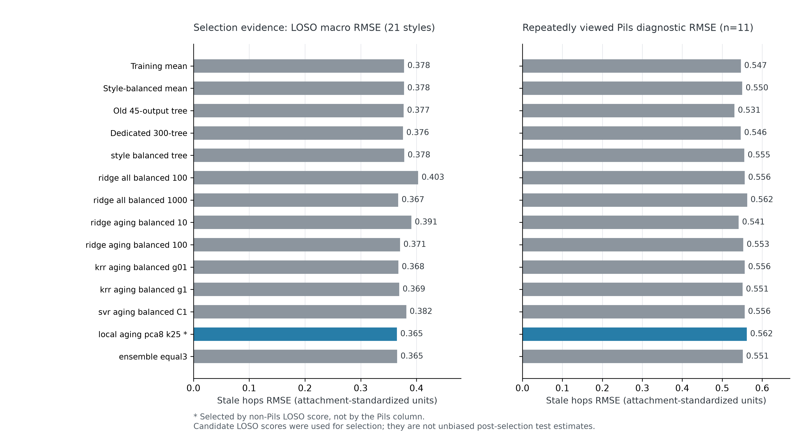
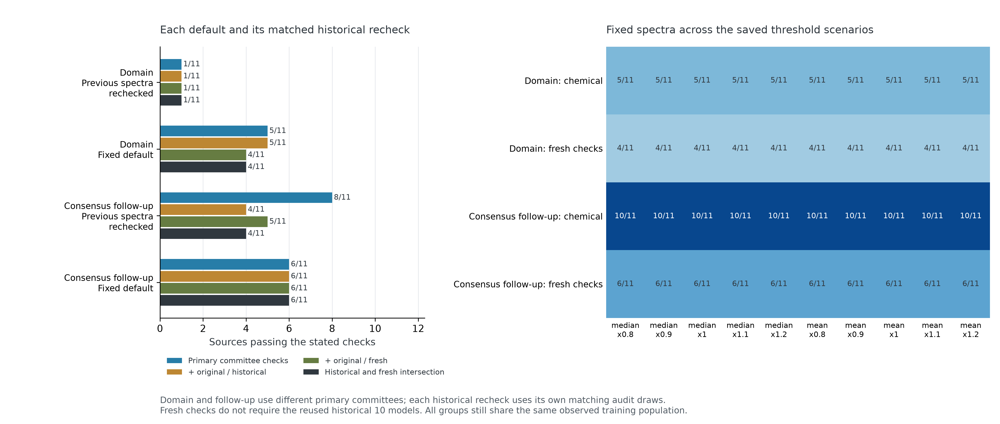
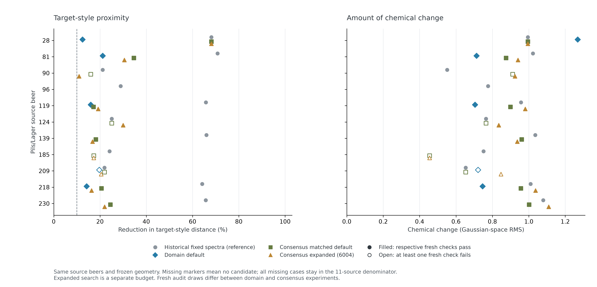

# 第三问：Pils预测未改善，联合筛查只有有限收益

在 239 款非 Pils 啤酒的 21 风格留一验证中，保存的主模型为 `local_aging_pca8_k25`。其宏 RMSE 为 **0.3650**，较优均值基线为 **0.3775**；但 Pils 的诊断 RMSE 为 **0.5615**，同轮旧多输出结构重训为 **0.5307**，固定专用树为 **0.5464**。**没有实现 Pils 跨风格预测改善。**

局部域模型的固定默认迁移仅选出 **5/11** 款，其中 **4/11** 通过 fresh 一致检查。随后沿旧固定树协议做联合筛查消融：同 **2004** 候选预算默认策略通过 **6/11**，历史固定谱在同一追加实验规则下重检通过 **5/11**；预算扩为 **6004** 后为 **8/11**。追加实验由前一轮失败触发，属于探索性策略比较，没有据此替换默认或证明预测精度提高。

## 风格留出分数与Pils诊断

完整 LOSO 每次排除一种非 Pils 风格，在 21 折分别拟合预处理和预测器。选择量为风格宏 RMSE 加上预声明的风格绝对偏差惩罚；风格宏平均给每种风格相同权重，与按啤酒数量加权的 pooled RMSE 不同。
本轮惩罚系数为 0.25，选中方法的宏绝对偏差为 0.1565，选择分数为 0.4041，样本加权 LOSO RMSE 为 0.4274。

LOSO 得分参与了方法选择，最低分存在选择乐观；未另设外层来检验整个选择器。Pils 标签此前已反复查看，本轮明确视为诊断集。配置选择在保存 LOSO 结果后完成，没有把 Pils 列中最低误差的配置替换为主方法，也没有按 Pils 标签校正截距。

|方法|LOSO宏RMSE|宏绝对偏差|选择分数|Pils诊断RMSE|主方法|
|---|---:|---:|---:|---:|---|
|`mean_global`|0.3778|0.1641|0.4188|0.5466||
|`mean_style_balanced`|0.3775|0.1640|0.4185|0.5502||
|`old_multioutput_tree`|0.3771|0.1630|0.4178|0.5307||
|`fixed_single_tree`|0.3758|0.1667|0.4174|0.5464||
|`style_balanced_tree`|0.3781|0.1687|0.4203|0.5552||
|`ridge_all_balanced_100`|0.4031|0.1760|0.4471|0.5564||
|`ridge_all_balanced_1000`|0.3673|0.1532|0.4056|0.5625||
|`ridge_aging_balanced_10`|0.3908|0.1799|0.4358|0.5413||
|`ridge_aging_balanced_100`|0.3706|0.1619|0.4110|0.5527||
|`krr_aging_balanced_g01`|0.3675|0.1583|0.4071|0.5563||
|`krr_aging_balanced_g1`|0.3691|0.1653|0.4104|0.5509||
|`svr_aging_balanced_C1`|0.3817|0.1617|0.4221|0.5561||
|`local_aging_pca8_k25`|0.3650|0.1565|0.4041|0.5615|是|
|`ensemble_equal3`|0.3654|0.1596|0.4053|0.5514||



图1：全部 14 个预声明配置的非 Pils 风格宏 RMSE 与全 11 款 Pils 诊断 RMSE。蓝色只标记按 LOSO 规则选中的配置，未构造独立置信区间。

同轮固定专用树的 Pils 平方误差中，**85.1%** 来自 beer **81**，其真实值为 1.6182。主局部模型对同一源预测 -0.1128，该源贡献主模型平方误差的 **86.4%**。所有主指标保留全部源，没有删除影响最大的样本或以该源单独调整方法。

局部模型的 bootstrap 邻域诊断中，每次名义上的 25 个近邻平均仅含 16.54 款不同啤酒；相对全量拟合邻域的 Jaccard 中位数为 0.50。有放回抽样同时改变邻居、重复权重和拟合空间，说明训练内方差门槛不足以保证迁移配对差稳定。域模型因此保留为失败探索，不据其训练分数替代原有预测基准。

## 两项迁移实验与检查口径

第一项使用 LOSO 选出的局部域模型；第二项在看到其候选覆盖不足后，沿此前固定专用树协议追加联合筛查消融。追加实验重新固定默认策略和审计种子，仍然复用同一批源和训练总体，不能视为独立确认实验。

每项实验都保存三种策略与两种预算：`single_geometry` 只用主筛选委员会并按几何目标排序；`joint_geometry` 加原筛选委员会约束，仍按几何目标排序；`joint_margin` 优先最小化两组筛选 Q95 的较差值，再按几何目标排序。默认都是保存协议中的 matched 预算和 joint_margin；扩池结果单列，未依据审计通过数重选默认。

检查定义如下：

- **主代理**：主筛选委员会与该实验的主审计检查通过。
- **历史一致**：再要求原筛选委员会及已在先前实验中使用的原后10模型通过。
- **fresh一致（主口径）**：主代理加原筛选委员会、fresh原协议20模型；**不要求历史10模型通过**。
- **全部交集**：历史一致和fresh一致同时成立。

原中心预测器是45输出模型，但原40个bootstrap模型本身是单目标120树协议。追加实验的两组新审计也沿单目标120树协议，只是种子不同，不能称为独立架构验证。所有组共享同一真实训练总体；historical与fresh采用并列定义，非逐层包含。

|实验|预算|策略|源数|选出|主代理|历史一致|fresh一致|全部交集|选出谱改善中位数|选出谱改动RMS中位数|
|---|---|---|---:|---:|---:|---:|---:|---:|---:|---:|
|局部域模型|matched_2004|single_geometry|11|6|4|2|1|1|23.6%|0.751|
|局部域模型|matched_2004|joint_geometry|11|5|3|3|2|2|26.0%|0.755|
|局部域模型|matched_2004|joint_margin|11|5|5|5|4|4|16.0%|0.721|
|局部域模型|expanded_6004|single_geometry|11|8|4|2|1|1|20.7%|0.740|
|局部域模型|expanded_6004|joint_geometry|11|5|3|3|2|2|26.0%|0.754|
|局部域模型|expanded_6004|joint_margin|11|5|5|5|4|4|14.2%|1.141|
|固定树追加实验|matched_2004|single_geometry|11|11|8|4|5|4|64.2%|0.957|
|固定树追加实验|matched_2004|joint_geometry|11|10|7|4|6|4|59.3%|0.870|
|固定树追加实验|matched_2004|joint_margin|11|10|6|6|6|6|21.3%|0.905|
|固定树追加实验|expanded_6004|single_geometry|11|11|9|5|6|5|64.2%|0.957|
|固定树追加实验|expanded_6004|joint_geometry|11|10|8|5|7|5|59.3%|0.871|
|固定树追加实验|expanded_6004|joint_margin|11|10|9|9|8|8|19.9%|0.938|

改善与改动中位数只在各行选出谱中计算；选出数量不同，不可忽略分母直接比较。未找到候选的源计为未通过，保留在全部源分母。

历史报告在原规则下为 9/11 主代理通过、6/11 新旧一致通过。这些旧口径不含本轮主代理和fresh审计，不能和本轮数字直接计算提升。每项实验都对同一历史固定谱按该实验相同模型和规则重新计算：

|重检所用实验|历史固定谱主代理|历史一致|fresh一致|全部交集|
|---|---:|---:|---:|---:|
|局部域模型|1/11|1/11|1/11|1/11|
|固定树追加实验|8/11|4/11|5/11|4/11|



图2：每项固定默认策略及其历史固定谱重检；右侧为默认固定谱跨全部阈值情景的化学保护及fresh一致通过数。两项实验的主代理和审计抽样不同，跨实验数字是探索性对照；同项重检才使用完全匹配规则。

## 阈值情景、风格接近与改动代价

化学投影同时保护保存的中位数/均值及各乘数情景；每项缺陷超阈程度均不得增加。trans-2-nonenal 无附件阈值时采用浓度不得增加。所有情景检查同一个已选谱，没有逐情景重新挑候选。下表化学保护计数也要求已选出谱，未选出的源没有可检查迁移谱，计为未通过而非伪造浓度。

|阈值情景|域默认化学保护|域默认fresh|固定树默认化学保护|固定树默认fresh|
|---|---:|---:|---:|---:|
|median_x0.8|5/11|4/11|10/11|6/11|
|median_x0.9|5/11|4/11|10/11|6/11|
|median_x1.0|5/11|4/11|10/11|6/11|
|median_x1.1|5/11|4/11|10/11|6/11|
|median_x1.2|5/11|4/11|10/11|6/11|
|mean_x0.8|5/11|4/11|10/11|6/11|
|mean_x0.9|5/11|4/11|10/11|6/11|
|mean_x1.0|5/11|4/11|10/11|6/11|
|mean_x1.1|5/11|4/11|10/11|6/11|
|mean_x1.2|5/11|4/11|10/11|6/11|



图3：全部源的历史固定谱、域模型默认、固定树matched默认及同策略expanded谱。左为冻结旧几何下的目标距离改善，右为同一高斯空间的改动RMS；历史灰点只作几何参考。其他实心点通过各自fresh检查，空心点失败，缺点表示无候选。expanded使用更多搜索预算，未替换matched默认。

追加实验 expanded joint_margin 的 8/11 fresh通过伴随目标接近度代价。历史固定谱的目标改善中位数为 64.2%，expanded选出谱为 19.9%；改动RMS的对应差别与全部策略见上表。边际安全余量与几何最优并不一致，不能只用较高通过数量概括结果。

|expanded joint_margin源|状态|目标改善|改动RMS|较差筛选Q95|主audit Q95|fresh原协议Q95|fresh通过|
|---|---|---:|---:|---:|---:|---:|---|
|28|all_checks_passed|68.1%|0.995|-0.2319|-0.2505|-0.1889|是|
|81|all_checks_passed|30.5%|0.940|-0.0958|-0.0974|-0.1229|是|
|90|all_checks_passed|10.9%|0.924|-0.0392|-0.0069|-0.0209|是|
|96|no_candidate_found|—|—|—|—|—|否|
|119|all_checks_passed|19.2%|0.980|-0.0861|-0.0983|-0.0380|是|
|124|all_checks_passed|30.0%|0.835|-0.0162|-0.0037|-0.0014|是|
|139|all_checks_passed|16.8%|0.936|-0.0568|-0.0611|-0.0401|是|
|185|new_audit_failed|17.3%|0.455|-0.0004|+0.0010|-0.0138|否|
|209|fresh_original_audit_failed|20.5%|0.847|-0.0077|-0.0168|+0.0037|否|
|218|all_checks_passed|16.3%|1.037|-0.1118|-0.1047|-0.1386|是|
|230|all_checks_passed|22.0%|1.109|-0.0822|-0.1047|-0.0988|是|

通过谱中最接近筛选边界的是源 124，较差筛选Q95为 -0.0162。这类临界结果应保留连续数值，不把微小负值解释为具有品评置信保证。

## 范围与复现

本轮仍未证明跨风格Stale hops准确预测改善。LOSO模型选择、候选搜索及多次追加实验复用现有数据，fresh只指新重采样模型，未带来新的独立啤酒或真实品评。固定结构bootstrap也未包含算法选择、测量误差和生成谱分布偏移；配对差Q95不是覆盖率校准的置信上界。

所有感官值保持附件标准化量表，未恢复0–6分。当前输出是化学目标谱和模型内筛查，需要新增真实风格样本及迁移后的理化、品评实验，才能判断真实Stale hops是否不增加。

- LOSO与Pils诊断：`../outputs/q3_domain/stale/`。
- 域模型迁移失败探索：`../outputs/q3_domain/transfer/`。
- 固定树联合筛查追加实验：`../outputs/q3_domain/consensus/`。
- 本报告计算表：`../outputs/q3_domain/report_tables/`。
- 三张图的PNG/SVG：`../outputs/q3_domain/figures/`。
- 输入逐文件哈希与行数：`../outputs/q3_domain/report_source_manifest.json`。

```bash
.venv/bin/python solution_a/src/18_q3_domain_report.py
```
