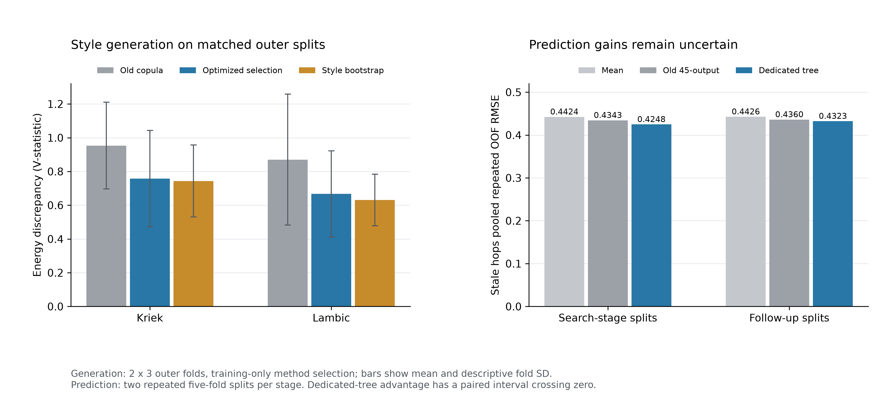
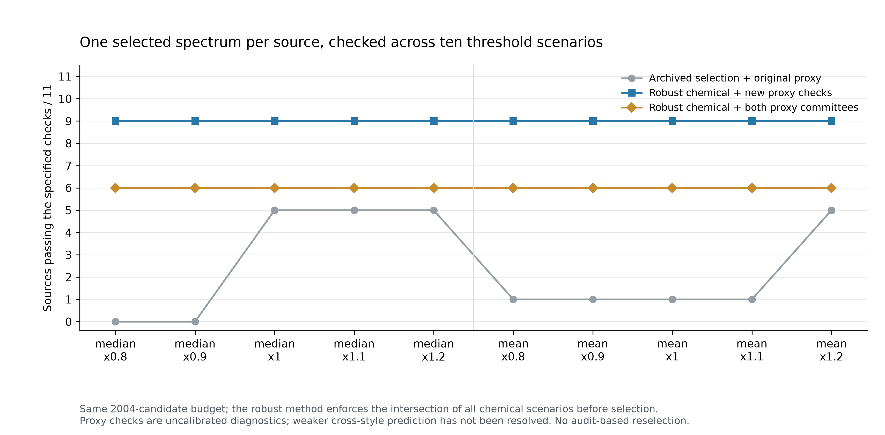
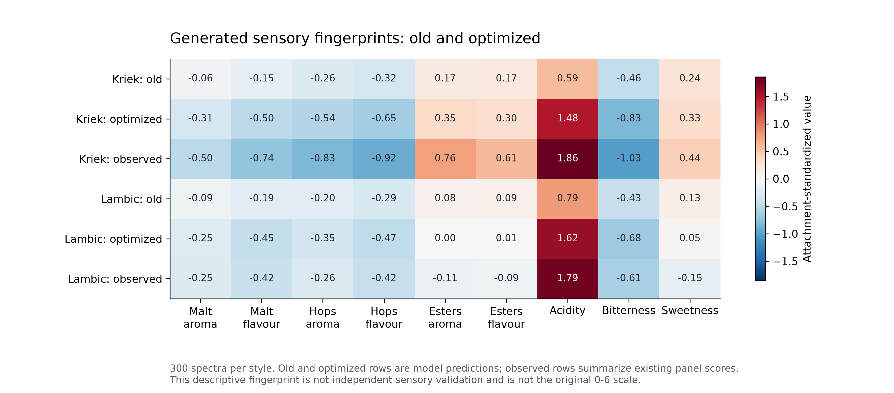

# 第三问优化：风格保真性、缺陷预测与阈值稳健迁移

日期：2026-10-23。原始第三问65个结果文件已冻结并逐文件校验；优化结果另存 `../outputs/q3_optimized/`。

## 1. 本轮结论

- Kriek、Lambic的嵌套选择生成算法，在匹配外层划分和共同评价坐标下，能量差异指标较旧模型分别降低 **20.5%**、**23.4%**。两者仍略逊于重采样，不能称所有质量指标全面胜出。
- Stale hops专用树在后续重复切分中，RMSE由 **0.4360** 降为 **0.4323**，下降 **0.85%**。按beer配对重采样的差异区间跨零，且Pils整风格留出更差，**尚未证实稳定的预测提升**。
- 默认迁移在10个预定阈值情景下同时约束化学保护，11款源均找到候选，**9**款通过新代理检查，**6**款同时通过旧冻结代理检查。旧固定谱在同一完整阈值网格下通过全部模型与化学检查的数量为 **0**。

模型检查仅定义本次候选筛查的通过范围，不证明实际品评结果。阈值稳健性与感官预测准确性分别报告。

## 2. 生成模型：保留风格局部边缘

旧模型采用全局经验边缘并向全局均值收缩，会削弱小样本风格的独特分布。本轮预声明三个候选：风格局部边缘copula、风格中心平滑混合、旧copula。局部模型保留目标风格边缘支持；平滑混合使用固定0.45噪声强度。内层使用新颖性门槛，避免以近似复制训练行制造误差下降。

外层为2×3折风格分层切分，种子20261123、20262123；每个训练集内2折选择方法，所有候选统一在该训练折旧copula的高斯秩空间及5维PCA参考坐标下评价。每折每法300条、2个模拟种子。内层选择不读取外层目标数据；这些新划分仍复用同一250款酒，属于重复内部验证。

| 风格 | 旧模型能量差异 | 嵌套选择能量差异 | 相对下降 | 重采样对照 | W1跨特征中位数：旧→新 |
|---|---:|---:|---:|---:|---:|
| Tripel | 0.2866 | 0.2939 | -2.5% | 0.3218 | 0.4182 → 0.4324 |
| Kriek | 0.9528 | 0.7575 | +20.5% | 0.7434 | 0.5345 → 0.4701 |
| Lambic | 0.8701 | 0.6669 | +23.4% | 0.6304 | 0.4913 → 0.4114 |
| Pils/Lager | 0.8098 | 0.5001 | +38.2% | 0.5736 | 0.4116 → 0.3023 |

能量指标为未开平方的经验V统计量，越小越好。平均W1、相关差异、零频率、多样性和复制检查也完整保存；Kriek平均W1仍被极端化合物支配，不能只看某一项指标。外层折与重复并不独立，折间标准差不是置信区间。

全250款重新训练后的风格选择为 `{"Tripel": "legacy_copula", "Kriek": "style_margin_copula", "Lambic": "style_smoothed_mixture", "Pils/Lager": "style_margin_copula"}`。四风格各生成300条谱，原始完整行及忽略训练缺失格后的观测行复制率均为0。

## 3. Stale hops：比较失败与有限改善均保留

18个配置包括稳健线性、PLS、SVR和树模型；特征限于226个化学指标及附件aging元数据确定的子集，不使用实际其他感官评分或评论特征。处理、筛选和调参均在训练折内部。内层预测方差比至少0.05才进入合格配置，再按RMSE选择。

搜索算法本身的嵌套结果为RMSE **0.4382**，劣于同划分旧森林的 **0.4343**。因此没有把外层表现最好的家族直接替代为“无偏最优模型”。

固定单目标森林保留原基线的300树、min_leaf=3、max_features=0.7参数，不再调参；在额外种子20263123、20264123的5折切分复核。这个后续算法选择由前一轮结果触发，因此仍是探索性复核，并非全新独立测试。

| 阶段 | 模型 | 重复OOF RMSE | R² | Spearman | 预测SD/实际SD |
|---|---|---:|---:|---:|---:|
| 模型搜索阶段 | 旧45目标森林 | 0.4343 | 0.0287 | 0.2055 | 0.172 |
| 模型搜索阶段 | 固定单目标森林 | 0.4248 | 0.0709 | 0.3011 | 0.332 |
| 固定方案后续复核 | 旧45目标森林 | 0.4360 | 0.0210 | 0.1911 | 0.186 |
| 固定方案后续复核 | 固定单目标森林 | 0.4323 | 0.0376 | 0.2599 | 0.341 |

固定方案两次切分一好一坏。先按beer平均两次切分平方误差，再对250款酒做2000次配对重采样：`新RMSE−旧RMSE` 点差 **-0.00371**，95%分位区间 **[-0.01565, +0.00967]**，包含零。它只描述已保存OOF误差的抽样波动，不包含模型选择过程，也没有重拟合模型。

Pils整风格留出11款时，专用树RMSE为 **0.5592**，劣于均值 **0.5466** 和旧代理 **0.5263**。这说明内部小幅改善未转化为跨风格预测提升。迁移代理资格门槛仅来自239款非Pils训练内验证，不等于已经通过源风格外推验证。

## 4. 同时保护10种阈值情景

定义情景集合为中位数/均值两种口径分别乘以0.8、0.9、1.0、1.1、1.2。对每个缺陷要求所有情景的超阈程度均不增加：

`c'_d ≤ min_s max(T[d,s], c_source[d]) = max(min_s T[d,s], c_source[d])`。

相应最严格阈值为DMS **13.8 μg/L**、Diacetyl **0.072 mg/L**、4VG **0.16 mg/L**。trans-2-nonenal没有附件阈值，继续采用浓度不得增加。保护依据为源的观测校准值，不以插补值替代。

迁移仍排除全部11款Pils训练数据，使用冻结的原239款训练几何和完整226维最近邻支持规则；目标距离至少改善10%、改动RMS至少0.05的条件保持不变。新旧生成器各500条、4个插值比例加4个共同目标中位谱，匹配预算均为2004候选；合并池4004候选单独报告。

239款重新训练的Tripel生成方法仍为旧copula，相同种子的新旧基础池完全一致：**True**。因此本轮Tripel迁移改善不能归因于生成器更换，主要改变来自同时阈值约束和专用代理筛选；Kriek、Lambic的生成改善是独立结果。

专用代理有60个固定结构bootstrap模型，前40个筛选，后20个仅审计已选谱；方差和候选差异门槛用于识别近常数代理。旧30/10委员会仅对已选谱做冻结架构一致性检查，不参与重选。所有模型均排除全部11款源；不同模型仍共享239款真实训练数据，分位数不是95%真实风味保证。

| 源beer | 默认方案状态 | 目标距离改善 | 新代理审计Q95 | 同时通过旧代理 |
|---|---|---:|---:|---|
| 28 | 新代理审计通过 | 68.1% | -0.2668 | 是 |
| 81 | 新代理审计通过 | 70.8% | -0.0624 | 是 |
| 90 | 新代理审计通过 | 21.1% | -0.0283 | 否 |
| 96 | 新代理审计未通过 | 28.9% | +0.0119 | 否 |
| 119 | 新代理审计通过 | 65.8% | -0.1061 | 是 |
| 124 | 新代理审计通过 | 25.1% | -0.0006 | 是 |
| 139 | 新代理审计通过 | 66.0% | -0.0292 | 否 |
| 185 | 新代理审计未通过 | 24.1% | +0.0049 | 否 |
| 209 | 新代理审计通过 | 21.9% | -0.0160 | 是 |
| 218 | 新代理审计通过 | 64.2% | -0.0372 | 否 |
| 230 | 新代理审计通过 | 65.7% | -0.0976 | 是 |

默认有 **9/11** 通过新代理检查、**6/11** 通过新旧代理共同检查，其化学保护在全部10个阈值情景中保持通过。这里的稳定性来自预先施加的情景交集约束，不能外推为任意未知阈值下都稳定。

## 5. 画像与结果文件

四种风格各300条谱及1200×45画像已保存。其他44维使用原全量感官预测器，Stale hops由本轮239款非Pils专用树输出；没有把它们描述为全45维新训练模型。感官尺度仍为附件标准化数值，不能当作恢复的原始0–6分。

- 生成谱与完整分布验证：`../outputs/q3_optimized/generation/`。
- 18配置嵌套搜索：`../outputs/q3_optimized/stale/`；固定专用树复核：`../outputs/q3_optimized/stale_fixed/`。
- 逐项情景保护、候选筛选、审计及三种λ结果：`../outputs/q3_optimized/transfer/`。
- 画像：`../outputs/q3_optimized/generated_sensory_profiles.csv` 和 `generated_sensory_summary.csv`。
- 实现：`11_q3_generation_optimized.py`、`12_q3_stale_optimized.py`、`12b_q3_stale_fixed.py`、`13_q3_transfer_optimized.py`。
- 一键复现：仓库根目录执行 `.venv/bin/python solution_a/run_q3_optimized.py`。原第三问对照已冻结，此入口不重写旧结果。

方法与审查详见 `q3_generation_optimized.md`、`q3_stale_optimized.md`、`q3_optimization_review.md`。数值校验见 `../outputs/q3_optimized/verification.json`。当前结果不包含真实酿造或迁移后的品评实验，Stale hops预测可靠性仍是主要瓶颈。
