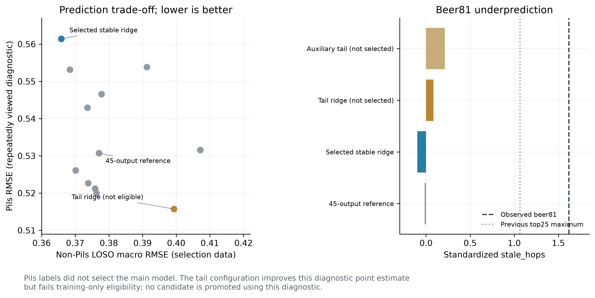
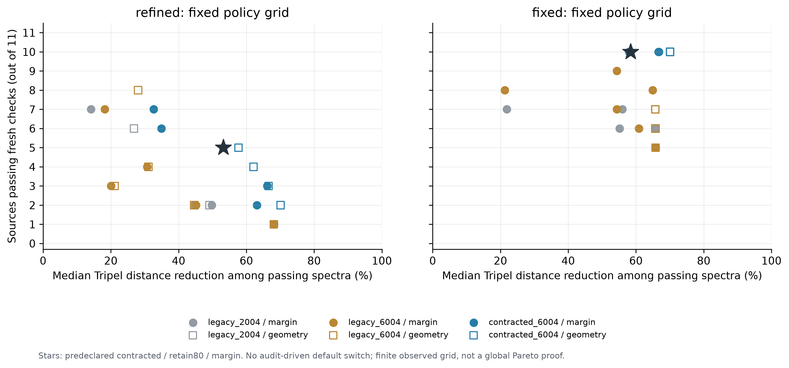

# 第三问：beer 81误差诊断与迁移接近度保留

## 本轮结果

beer 81身份连接正确，陈旧感目标为 **1.6182**（全250款第5高）。论坛术语表也有较高的陈旧/纸板/纸质描述；没有证据据此改标签或删除该样本。
稳定性选型保留 `stable_ridge_all1000`，Pils诊断RMSE **0.5614**，仍未优于本轮旧45输出对照 **0.5307**。预声明尾部加权备选的Pils点误差为 **0.5157**，但其非Pils留出误差变差，未获准替换主模型。
主预测模型迁移臂通过 **5/11**；固定树方法对照的中央候选、retain80、margin通过 **10/11**，所选谱目标距离改善中位数 **57.7%**。两臂分别报告，没有依据审计把较高通过数的一臂改名为默认。

## beer 81为什么难预测

1.csv与8.xlsx精确条码一致，4.csv/7.csv条码只是给定精度较低；始终以beer精确连接。该行混合化学输入没有缺失或非法校准负值，只有1项略超非Pils训练范围。相对量中重复负值是附件给定表示，不能擅自当作浓度或检测下限。
旧局部模型的25近邻目标范围为 [-0.3668, 1.0643]，实际值1.6182超出该凸包，非负加权均值结构无法达到它。训练239款中仅4款同等高尾，且均不在这25个近邻中。这说明高缺陷尾部稀疏、化学相似性与该感官目标不一致，不能证明所有化学模型都不可能预测。
新主模型对81预测 **-0.0979**，尾部加权备选为 **0.0845**，仍明显低估。缺陷可能涉及未记录的储存、批次或品评差异，当前附件无法识别真实原因。7.csv是数值术语表而非原始评论；它仅用于语义佐证，未用作生成谱推理特征。所有Pils主指标保留11源。

## 预测的内部改善与外推代价

固定缺失指示维数、平滑岭回归、辅助感官训练监督及训练内尾部权重均为本轮预声明比较。辅助44感官只在训练阶段学习化学方向，推理只接受226维化学输入。主规则先应用完整风格留出精度与非退化门槛，再在一标准误差容忍带内按训练内响应稳定性选择。该容忍带是选择启发式，不是置信区间。
4外层分组、内层完整风格留出评价整个规则：pooled RMSE **0.4200**，同折旧45输出树 **0.4280**、固定单目标树 **0.4237**。这是复用本批非Pils数据的嵌套内部点比较，不是新增外部测试。
|配置|LOSO宏RMSE|LOSO pooled RMSE|Pils诊断RMSE|训练内准入|主方法|
|---|---:|---:|---:|---|---|
|mean_global|0.3778|0.4380|0.5466|否||
|old_multioutput_tree|0.3770|0.4357|0.5307|否||
|fixed_single_tree|0.3736|0.4284|0.5429|否||
|stable_ridge_aging100|0.3684|0.4281|0.5531|是||
|stable_ridge_all1000|0.3658|0.4260|0.5614|是|是|
|tail_ridge_aging100|0.3993|0.4413|0.5157|否||
|aux4_ridge10|0.3739|0.4413|0.5227|否||
|aux8_ridge10|0.3759|0.4427|0.5212|否||
|aux4_tail_ridge10|0.4072|0.4616|0.5316|否||
|aux4_smooth_kernel|0.3763|0.4465|0.5199|否||
|style_center_within_ridge|0.3913|0.4473|0.5538|否||
|equal3_supervised_ensemble|0.3701|0.4282|0.5261|是||

尾部备选的LOSO宏RMSE为0.3993、pooled为0.4413，Pils R²仍为-0.0007，因此不能因Pils较小就后验换主方法。全部可选配置工件均保存于 `../outputs/q3_refined/stale/candidate_models/`，未选配置明确标作开发诊断。

|60次bootstrap响应|噪声RMS|信号RMS|噪声/信号|
|---|---:|---:|---:|
|refined_selected|0.0768|0.1220|0.6299|
|domain_local_previous|0.2949|0.3799|0.7761|

响应对由非Pils真实化学邻居固定产生；其中包含拟合内点，只是训练内稳定性诊断，不能证明迁移后的真实感官因果效应。



## 同时保护一致性与Tripel接近幅度

新增中央候选把冻结500个目标谱经原高斯秩映射后，按0.2/0.4/0.6向Tripel中心收缩，再经经验逆CDF还原。它是搜索proposal，不当作更高质量生成模型的证据；每源投影后重新检查原完整226维几何、NN支持和十阈值保护。
1500个中央目标谱中有1500个唯一向量。逐源投影后去重数和重复率另存pool_uniqueness.csv；6004表示名义预算，不等于6004个独立新样本。
retain80要求每源保留最早冻结默认谱至少80%的目标距离改善，并保持最少10%改善。另完整保存retain100及绝对10%/30%/50%/60%下限、两种排序、三个池的经验权衡网格。默认在审计前固定为refined/contracted_6004/retain80/margin，没有根据审计改选。
筛选同时要求新旧委员会配对Q95不增加及两个中心预测不增加。旧中心确为45输出模型，但旧bootstrap仍是单目标120树；45输出中心只作单点一致检查，不声称已做该架构的bootstrap审计。新20与新种子旧协议20只审计已选谱，失败不重选。

|臂|候选池|retain80排序|选出/11|fresh通过/11|通过谱改善中位数|所选谱改善中位数|保留率中位数|
|---|---|---|---:|---:|---:|---:|---:|
|fixed|contracted_6004|geometry|11|10|70.1%|70.1%|108.1%|
|fixed|contracted_6004|margin|11|10|58.4%|57.7%|101.8%|
|fixed|legacy_2004|geometry|9|7|65.7%|64.2%|100.0%|
|fixed|legacy_2004|margin|9|7|56.0%|54.4%|100.0%|
|fixed|legacy_6004|geometry|9|7|65.7%|64.2%|100.0%|
|fixed|legacy_6004|margin|9|9|54.4%|54.4%|93.7%|
|refined|contracted_6004|geometry|5|3|66.6%|57.7%|101.2%|
|refined|contracted_6004|margin|5|5|53.2%|53.2%|82.8%|
|refined|legacy_2004|geometry|3|2|44.6%|27.2%|100.0%|
|refined|legacy_2004|margin|3|1|68.1%|27.2%|100.0%|
|refined|legacy_6004|geometry|4|3|21.1%|25.2%|100.0%|
|refined|legacy_6004|margin|4|3|20.1%|22.3%|94.7%|

同一臂、同一审计及下限才可直接比较。geometry是预声明几何优先对照，margin优先预测余量；两者的观察结果均保留，不按通过数宣布一个新默认。没有找到谱的源始终计入11分母。

|同本轮规则重检历史固定谱（retain80）|可用谱|fresh通过/11|原改善中位数|
|---|---:|---:|---:|
|fixed/original_anchor|11|6|64.2%|
|fixed/prior_expanded_6004|10|3|19.9%|
|fixed/prior_matched_2004|10|2|21.3%|
|refined/original_anchor|11|2|64.2%|
|refined/prior_expanded_6004|10|2|19.9%|
|refined/prior_matched_2004|10|1|21.3%|

上一轮保守谱的8/11和19.9%使用旧规则，不能直接当成本轮统计提升率；这里按新下限和同一新审计重检。



完整72个网格点见 `../outputs/q3_refined/transfer/frontier.csv`，792条策略记录、选谱、逐情景浓度及配对差均保留。这是有限候选的经验权衡，不证明连续空间的全局Pareto最优，也没有真实品评覆盖率。

## 复现与边界

Pils/81目标已经多轮查看，属于开发诊断。尾部候选的点改善、嵌套内部改善和模型检查通过均不能替代新批次外测。全部目标仍为附件标准化尺度，未恢复原0–6分。
诊断详见 `q3_beer81_audit.md`，预测方法见 `q3_stale_refined.md`，独立审查见 `q3_refinement_review.md`。

```bash
.venv/bin/python solution_a/run_q3_refined.py
```
