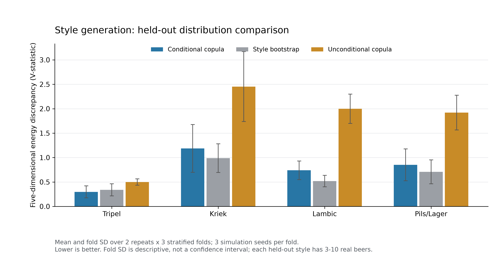
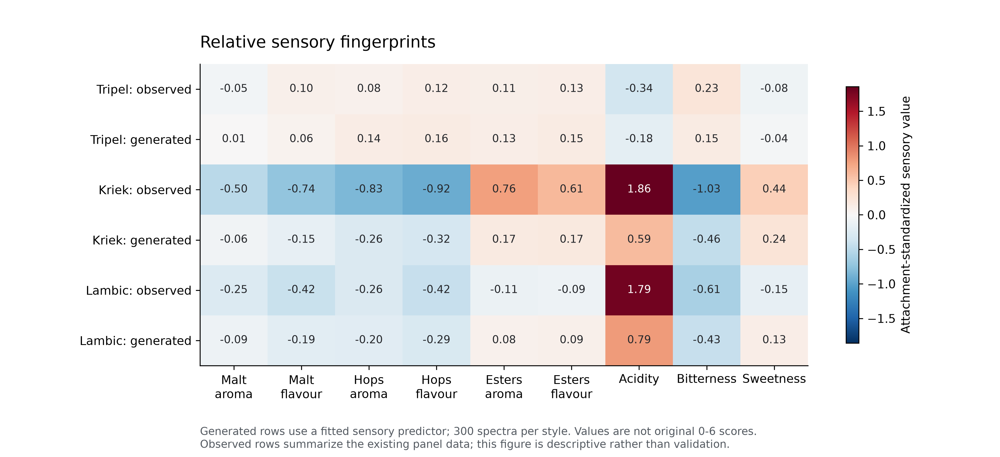
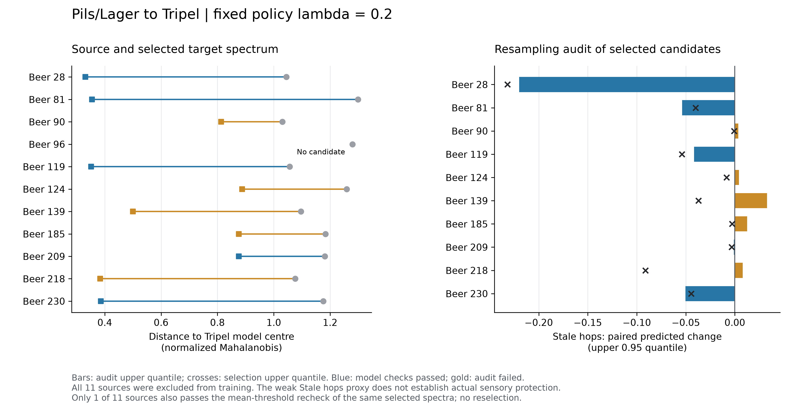

# 第三问：风格生成与跨风格迁移实验

日期：2026-10-23。全部数字由保存的模型、谱与验证表计算。复现入口为 `../run_q3.py`。

## 1. 运行结果

已生成 Tripel、Kriek、Lambic、Pils/Lager 各300条谱，共 **1200** 条，并给出45维连续感官画像。生成谱的69个校准字段均为非负，未出现完整训练行的直接复制；157个未校准字段保留相对量标记。

对11款Pils/Lager源样本进行Tripel方向迁移。默认λ=0.2、中位阈值口径下，**10**款找到筛选合格候选，**5**款通过全部模型检查，**5**款在保留的重抽样模型审计中未通过，**1**款未找到候选。同一选定谱改用均值阈值复核时，仅 **1/11** 仍通过全部检查。

这里的“通过”指本次明确定义的数值与模型检查。Stale hops预测较弱，结果需要实际品评检验后才能判断真实缺陷是否得到控制。

## 2. 统一数据表示

使用226维输入：原1.csv的231维去掉5项派生汇总，其中69维替换为8.xlsx按beer对应的校准原值，剩余157维保留原相对表示。3个负校准观测设为缺失，共72个缺失值；补值在每个训练折内部拟合。原始零值保留，未校准的负值保留原含义。每列来源、表示、单位与缺失记录见 `../outputs/q3/sensory/feature_manifest.csv`。

感官预测器按同一226维表示重新训练，五折折外RMSE为 **0.4865**。画像保持附件4的标准化尺度，尚不能解释成原始0–6分。生成谱的5%–95%预测分位数描述300条谱之间的分布范围，不是预测置信区间。

## 3. 风格条件生成

训练经验分布中秩映射到高斯空间；风格均值以n/(n+5)向全局均值收缩，协方差以n/(n+20)混合风格与共享风格内Ledoit–Wolf协方差。所有矩阵加微小对角正则以保证正定。经验逆CDF生成新的联合组合，单列仍取训练支持中的值。零值在逆CDF中有概率区间，但生成零频率不保证与经验频率完全一致，另有逐字段诊断。

固定主参数(5,20)，单独报告(2,5)、(10,50)敏感性；未用外层结果选择主参数。对22风格分层做2次重复×3折验证，每次比较条件生成、目标风格重采样、无条件生成；每法300条、3个模拟种子。每个风格的真实留出样本只有3–10款，模拟300条不能增加真实证据量。分割重叠，折间标准差属于描述性波动。

能量差异指标在训练折拟合的5维PCA标准化空间中计算：

`E = 2 mean||a-b|| - mean||a-a'|| - mean||b-b'||`。

它是包含对角项的经验V统计量，未开平方；越小越好。W1按训练IQR标准化，零IQR回退到训练range，再回退1。跨特征中位数作为稳健补充，完整均值与逐字段结果同时保存。

| 风格 | 条件生成E | 重采样E | 无条件E | 相对重采样改善 | W1跨特征中位数：条件/重采样 |
|---|---:|---:|---:|---:|---:|
| Tripel | 0.2974 | 0.3386 | 0.4978 | +12.2% | 0.3919 / 0.4116 |
| Kriek | 1.1861 | 0.9867 | 2.4530 | -20.2% | 0.5504 / 0.4721 |
| Lambic | 0.7390 | 0.5184 | 1.9986 | -42.6% | 0.4905 / 0.3863 |
| Pils/Lager | 0.8505 | 0.7075 | 1.9217 | -20.2% | 0.4226 / 0.3161 |

条件模型仅在Tripel的此项指标上优于重采样，其他风格未显示同样优势。重采样复制率为1，条件生成复制率为0，体现新颖性与分布保真性的权衡。Kriek的平均W1被极端化合物值支配，因此不能只凭平均W1判断模型优劣。模型适合提供可检查的候选谱，当前证据不足以宣称所有风格都已获得高保真生成。

相对画像中，Kriek与Lambic的酸度明显向中部收缩，反映小样本条件分布收缩和感官预测误差的共同影响；画像不能取代真实品评。

训练内Mahalanobis距离参考较乐观，全部生成谱都超过训练内95%距离分位；采用重复留出真实样本的参考范围时结果明显不同。两种标记均保留在generated_diagnostics.csv，属于描述性参考，不构成已校准的可行性保证。未用事后放宽支持规则来改变迁移结果。

## 4. 缺陷保护迁移

全部11款源Pils/Lager排除出迁移Copula、45维感官代理和40个Stale hops重抽样模型训练。迁移训练集239款；源的四项缺陷浓度均有原始校准观测。若缺失，流程返回不可核验，不用插补值充当保护依据。

| 缺陷 | 字段 | 单位 | 中位阈值 | 均值阈值 |
|---|---|---|---:|---:|
| DMS | `DMS` | ug/L | 19.0 | 17.25 |
| Diacetyl | `X2.3.butanedione` | mg/L | 0.09 | 0.29925 |
| 4VG | `X4VG` | mg/L | 0.2 | 0.206333333 |
| trans_2_nonenal | `X.E..2.nonenal` | mg/L | 缺失 | 缺失 |

有阈值项约束`max(c'/T-1,0) <= max(c_source/T-1,0)`，等价为`c' <= max(T,c_source)`。trans-2-nonenal未提供阈值，采用浓度不得增加的替代约束。4VG按题面列出的保护项执行，不据此推论它在所有风格中都属于缺陷。

每源固定500条条件谱×4个插值比例，加4个目标中位谱插值，共2004个候选；投影后重新计算全部距离及预测。通过条件为：四项化学约束、目标距离至少改善10%、全226维高斯秩空间的目标最近邻距离不超过Tripel训练LOO距离95%分位、所有字段处于非源训练边缘范围、改动RMS至少0.05，以及30个选择模型的配对预测差上0.95分位≤0。

在可行集合内最小化`目标距离/源目标距离 + λ × 改动RMS/源到目标中心RMS`。固定λ为0.05、0.2、1.0，默认0.2；后10个重抽样模型只审计已选谱，不参与重选。两组模型共享真实训练数据，其分位数是模型诊断，既不是独立实验，也没有经过95%覆盖校准。

| 源beer | 默认方案状态 | 目标距离改善 | 审计配对差Q95 | 同谱均值阈值也全部通过 |
|---|---|---:|---:|---|
| 28 | 通过模型检查 | 68.3% | -0.2199 | 是 |
| 81 | 通过模型检查 | 72.7% | -0.0538 | 否 |
| 90 | 重抽样审计未通过 | 21.1% | +0.0034 | 否 |
| 96 | 未找到合格候选 | — | — | 否 |
| 119 | 通过模型检查 | 66.7% | -0.0415 | 否 |
| 124 | 重抽样审计未通过 | 29.5% | +0.0043 | 否 |
| 139 | 重抽样审计未通过 | 54.4% | +0.0329 | 否 |
| 185 | 重抽样审计未通过 | 26.0% | +0.0125 | 否 |
| 209 | 通过模型检查 | 25.8% | -0.0011 | 否 |
| 218 | 重抽样审计未通过 | 64.3% | +0.0080 | 否 |
| 230 | 通过模型检查 | 67.2% | -0.0503 | 否 |

通过模型检查的源编号为 **28, 81, 119, 209, 230**，目标距离改善范围 **25.8%–72.7%**。同谱均值阈值也通过的编号为 **28**。DMS均值阈值17.25低于中位阈值19，故阈值口径会改变结果，不能省略这项敏感性。

## 5. 适用边界

Stale hops五折R²为 **0.0229**，RMSE **0.4356**；整风格留出11款Pils时R²为 **-0.0420**，RMSE **0.5263**。这一关键代理预测能力有限，总体45维预测表现不能替代缺陷目标的验证。候选搜索后的模型上分位约束也不能转化为真实风味不恶化的概率保证。

在28款真实Tripel中，对9个源样本没有真实目标酒同时符合四项化学保护上界，说明目标风格与保护条件存在张力。投影生成的是化学目标谱，尚未给出可实现该谱的配料或发酵控制方案。当前验证不包含生产实验、质量守恒或真实迁移后的品评。

## 6. 文件与复现

- `../outputs/q3/generation/generated_Tripel.csv`、`generated_Kriek.csv`、`generated_Lambic.csv`、`generated_Pils-Lager.csv`：各300条226维谱。
- `../outputs/q3/generated_sensory_profiles.csv`：全部1200条谱的45维画像；`generated_sensory_summary.csv`含均值、分位与真实风格均值。
- `../outputs/q3/transfer/transferred_spectra.csv`：三种λ下的保护方案及未加缺陷保护的基线谱；失败候选仍保留状态，不作为成功样本。
- `../outputs/q3/transfer/defect_checks.csv`、`sensory_before_after.csv`、`feature_changes.csv`：逐项缺陷、感官与特征改动。
- `../outputs/q3/transfer/candidate_diagnostics.csv`、`stale_paired_deltas.csv`：候选筛选与审计原始证据。
- `q3_generation.md`、`q3_representation.md`、`q3_method_review.md`：模型、数据表示及数值审查；`../outputs/q3/verification.json`为程序一致性检查。

在仓库根目录执行：`.venv/bin/python solution_a/run_q3.py`。本轮参数、源排除与候选判据均随代码保存。

数据来源为赛题附件1/4/8。协方差实现参照 [scikit-learn LedoitWolf文档](https://scikit-learn.org/stable/modules/generated/sklearn.covariance.LedoitWolf.html)，边缘距离使用 [SciPy Wasserstein-1实现](https://docs.scipy.org/doc/scipy/reference/generated/scipy.stats.wasserstein_distance.html)。风格收缩、迁移约束及候选审计是本题明确写出的建模选择，未声称由上述文档直接保证其效果。
