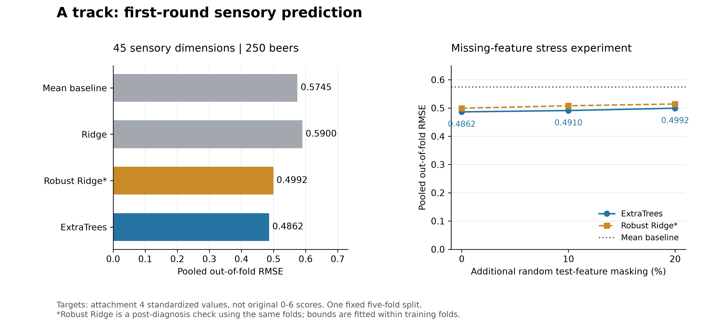

# A题首轮阶段结果

更新日期：2026-10-23。本文件保存开题与首轮实验的历史结果；第三问后续实验见 [第三问结果](q3_results.md)。

## 已确认的数据口径

- 250 款啤酒、231 个化学/理化特征，22 个风格；建模以 `beer` 一对一合并。
- 45 维 Aroma/Flavour = Aroma 15 + Taste 30；4.csv 另有 4 个 Palate 和 1 个 Overall 项。
- 3.xlsx 是 12 张空白评分卡。4.csv 是品评员标准化后聚合的连续标签。现有附件及已检查的作者公开包中，尚未识别出恢复真实 0–6 分所需的原始评分/参数。
- 2/5/6.csv 的矩阵均可由 Spearman 重现。全样本相关矩阵不能直接用作预测交叉验证的折外先验。
- 37 个基础指标的 log10 关系已实测；其余 GCMS 字段不能统一逆对数得到浓度。完整证据见 `data_audit.md` 和 `sensory_mapping_review.md`。

## 第一问：连续感官预测基线

所有指标均在附件既有连续尺度上计算。外层 5 折，岭回归内层 4 折选择正则强度；中位数补值、X/Y标准化及稳健裁剪均只拟合训练折。`beer/beer_id/风格` 没有进入预测特征。ExtraTrees 使用固定参数，未用外层结果调参。

| 模型 | MAE | RMSE | 宏平均 R² |
|---|---:|---:|---:|
| mean | 0.4096 | 0.5745 | -0.0076 |
| ridge | 0.4061 | 0.5900 | -0.0653 |
| extra_trees | 0.3409 | 0.4862 | 0.2146 |
| ridge_winsor | 0.3525 | 0.4992 | 0.1858 |

ExtraTrees 的 RMSE 比均值基线降低 **15.36%**。附加随机遮蔽20%测试特征时，RMSE 为 **0.4992**，较原实验上升 **2.67%**。这只是一次随机缺失压力实验，不代表检出限导致的非随机缺失。

弱预测维度（ExtraTrees R²<0.05）：A_esters_fruity (-0.011), F_esters_flower (0.012), stale_hops (0.018), barnyard (0.028), A_malt_grain (0.029), A_esters_isoaa (0.030), dms (0.039), F_malt_grain (0.045)。尤其 `stale_hops` 的预测能力很弱，第三问不能凭该模型就宣称实际缺陷已经受到可靠控制。

原岭回归被 beer=156 的极端化合物值严重影响；随机遮蔽20%时恰好隐藏该特征，造成误差降低。不得将其解释为“缺失更多提升模型”。稳健岭回归保留全部250款酒，在每个训练折内部按1%/99%分位裁剪后重跑。此实验由诊断触发、复用原划分，属于探索性稳健性检查，仍需新划分/重复验证。

## 第二问：网络、Top-3与稳定性

网络含231节点，|ρ|≥0.6/0.7/0.8分别有266/109/39条边。排除汇总和非单一化合物指标后，218候选×45目标共9,810条关联记录，完成200次配对行bootstrap。

135个Top-3位置中，入选频率≥0.8的仅 **14** 项；平均频率 **0.455**。Spearman/Pearson平均Jaccard为 **0.222**，去风格均值前后为 **0.160**，其中 **21** 个维度完全没有交集。

这些结果表明风格混杂、相关化合物替代和尺度影响需要进一步处理，不能把当前Top-3直接写成因果因素。下一轮应验证模块代表性、风格内分层bootstrap，并逐条核实气味机制。结果见 `../outputs/q2/top3_compounds.csv` 与 `../outputs/q2/README.md`。

## 第三问：首轮时点的设计方案

首轮拟采用小样本条件收缩Gaussian copula，以目标风格重采样为基线。后续已完成生成与迁移实验，完整结果见 [第三问结果](q3_results.md)。设计要求是对Tripel/Kriek/Lambic做训练折内拟合和留出分布验证，报告边缘距离、联合结构、多样性和最近邻记忆程度。

迁移必须逐项检查DMS/Diacetyl/4VG/trans-2-nonenal/Stale hops。对已知阈值项约束超阈程度不增加；对缺失阈值或未核验变换项另列更强替代约束和不可验证项。Stale hops只有感官代理，当前预测较弱。70个校准字段与其余相对量可以构成混合表示，但必须用同一表示重训感官模型，不能直接输入本轮模型。详细公式与验证方案见 `q2_q3_design_review.md`。

## 下一轮优先顺序

1. 明确0–6评分的可识别性边界；取得原始评分/校准数据，或有依据地声明相对等级的定义，分别验证连续值与等级误差。
2. 在新划分或重复交叉验证中比较ExtraTrees与稳健线性模型，加入与现有/未见风格相匹配的验证，评估维度级不确定性和弱缺陷目标。
3. 改善第二问的风格混杂与模块解释，完成化学机制文献核验。
4. 实现第三问并报告有效迁移与失败案例，随后整理完整论文和支撑材料。

## 来源与复现

原始附件保持原样，哈希记录在 `../outputs/audit/source_files.csv`。一键复现命令及文件索引见 `../README.md`。官方原研究为 [Schreurs等，Nature Communications 15,2368 (2024)](https://doi.org/10.1038/s41467-024-46346-0)，公开数据见 [Zenodo 10653704](https://zenodo.org/records/10653704)。来源对应核验详情已记录于感官映射报告。
